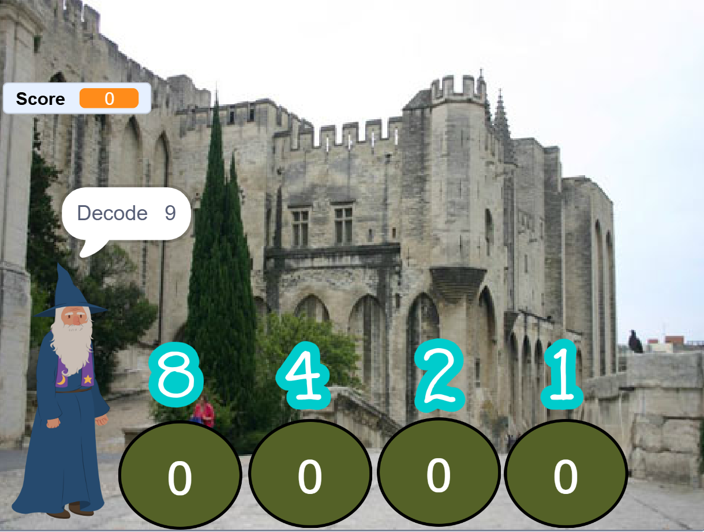

# DaVinci Binary Decode 🔐

An interactive 4-bit educational puzzle game built with **Scratch** that introduces players to the **Binary Number System (Base-2)** using powers of two (`8, 4, 2, 1`).

This project was designed and developed as part of **Harvard University's CS50: Introduction to Computer Science (Week 0)** and serves as a practical demonstration of foundational computer science principles.

---

## 🎮 How to Run the Game

* **Play Online (Live Interactive Demo):** [Click here to play DaVinci Binary Decode directly in your browser](https://github.io)
* **Source Code:** Download `DaVinci_Binary_Decode.sb3` from this repository and open it via [Scratch Online](https://mit.edu).

---

## 💡 Project Idea & Game Mechanics

Inspired by classic code-breaking puzzles and Renaissance problem-solving, **DaVinci Binary Decode** challenges players to crack secret numerical codes generated dynamically by converting numbers between **Decimal (Base-10)** and **Binary (Base-2)**.

By toggling bits (`0` and `1`) across four foundational binary place values (`8 - 4 - 2 - 1`), players visually experience how computers represent data using electrical states (`OFF/ON`).

### Key Gameplay Features:
* **Dynamic Random Generation:** Automatically generates target decimal values (1–15) and validates binary bit combinations in real time.
* **45-Second Challenge Timer:** Adds urgency and competitive pacing to test rapid mental conversion.
* **Progressive Difficulty (Level 2 Memory Mode):** Once the player reaches a score greater than `5`, the game advances to **Level 2**, dynamically hiding the visual place-value clues (`8, 4, 2, 1`) to test true binary mastery.
* **Dedicated Game Over State:** Displays a clean end-of-round overlay showcasing the player's final score and level achieved.

---

## 🧠 Computer Science Concepts Applied

* **Binary Representation & Positional Notation:** Applying Base-2 mathematics ($2^3, 2^2, 2^1, 2^0$) to compute decimal equivalents via the real-time formula: `(Bit_8 * 8) + (Bit_4 * 4) + (Bit_2 * 2) + (Bit_1 * 1)`.
* **Parallel Execution (Concurrency):** Running an independent 45-second countdown thread concurrently alongside the main input-validation game loop.
* **State Management & Broadcasting:** Using variables (`Score`, `Level`, `Time`, `Target`, `Current_Sum`) and event broadcasts (`reset`, `Hide_Clues`, `Game_Over`) to synchronize UI transitions across multiple sprites.
* **Conditional Logic & Loops:** Implementing `If/Else`, `Forever`, and `Repeat Until` control structures for continuous state evaluation.

---

## 📸 Screenshots

---

## 👨‍💻 Author

Developed by **Sharnoof** as part of an ongoing Computer Science learning journey (Harvard CS50) in preparation for undergraduate studies in **Computer Science in Italy**.
